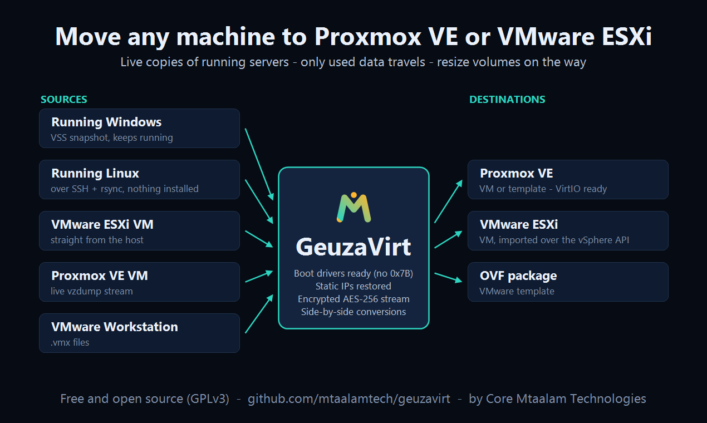
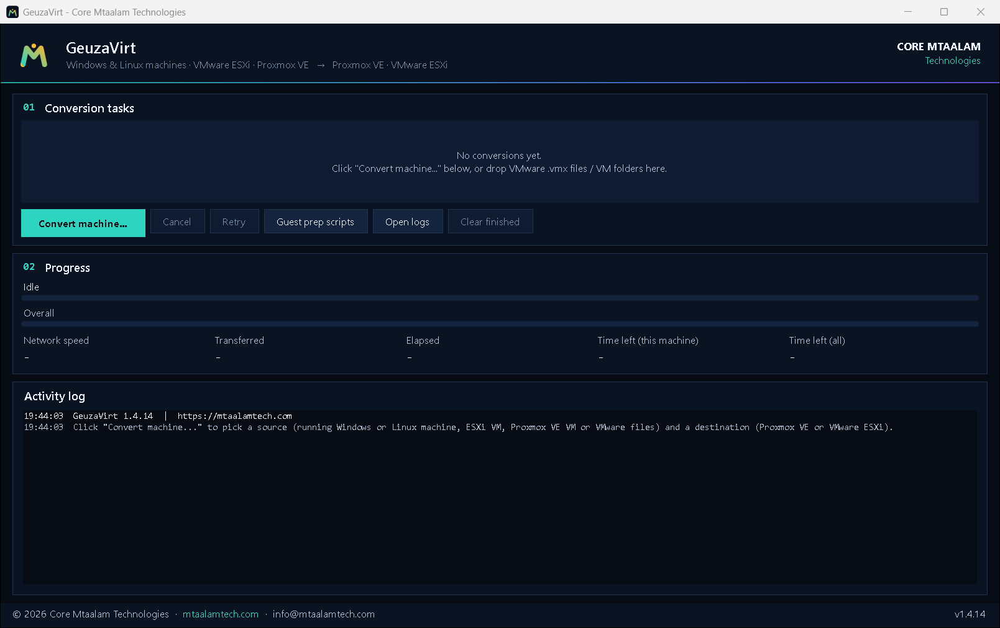

# GeuzaVirt

**Move running Windows and Linux machines, VMware VMs and Proxmox VMs to Proxmox VE or VMware ESXi, with a few clicks and no downtime while the copy runs.**



*Geuza* is Swahili for "turn" or "convert". GeuzaVirt is a Windows desktop app by
[Core Mtaalam Technologies](https://mtaalamtech.com). It works like VMware vCenter Converter
Standalone, but it also targets Proxmox VE.

> **Status: beta.** Production migrations have been completed with it: Windows Server to ESXi,
> and Linux servers to Proxmox VE. Some paths are newer and less tested; see
> [Limitations](#limitations). Read the log after every conversion.

## What it converts

| Source                                   | → Proxmox VE VM / template | → VMware ESXi VM / OVF |
|------------------------------------------|:--------------------------:|:----------------------:|
| This PC (Windows, running)               | ✓ | ✓ |
| Remote Windows machine (running)         | ✓ | ✓ |
| Remote Linux machine (running)           | ✓ | – |
| VMware ESXi virtual machine              | ✓ | ✓ |
| Proxmox VE virtual machine               | ✓ | ✓ |
| VMware Workstation `.vmx` files          | ✓ | – |



## Highlights

- **Live copies of running machines.**
  - **Windows:** the GeuzaVirt agent takes VSS snapshots and the machine keeps running. The agent
    is deployed automatically over `ADMIN$` with an administrator login.
  - **Linux:** copied over SSH with rsync. Nothing is installed on the machine.
- **Only used data travels.**
  - **Windows:** only the NTFS blocks in use are sent, with the page and hibernation files left out.
  - **Linux:** copied file by file.
  - The stream is encrypted (AES-256-CTR, HMAC-signed requests).
- **Resize while copying.** Windows NTFS volumes and Linux ext4/XFS/LVM volumes can be shrunk or
  grown. The new disk is created at the new size, never at the old one.
  - Windows volumes are rebuilt file by file with [wimlib](https://wimlib.net), keeping
    permissions, short names, hard links, reparse points and alternate streams.
- **Boots on the new hardware.**
  - **Before the snapshot:** VirtIO or LSI Logic SAS boot drivers are enabled, so there's no `0x7B` blue screen.
  - **Proxmox VMs:** VirtIO is set up and static IP addresses are restored.
  - **Linux:** the network card names are kept.
- **Straight to the destination.**
  - **Proxmox:** the Proxmox host pulls the disks directly from the source, so the data never passes through your PC.
  - **ESXi:** GeuzaVirt imports through the vSphere NFC API.
- **Several conversions side by side**, with Retry and one log file per conversion, named after the machine and the result.

## Requirements

- **Converter PC:** Windows 10 or 11 with the OpenSSH Client (installed by default on most PCs) and .NET Framework 4.x.
- **Proxmox VE:** 7.2 or newer, reachable over SSH as root.
- **VMware:** the ESXi host itself (not vCenter), on port 443.
- **Windows sources:** Server 2008 R2 / Windows 7 or newer, and an administrator account.
- **Linux sources:** SSH as root or as a sudo user, with rsync installed.
  - **Supported:** x86-64, ext2/3/4, XFS, swap, vfat, plain LVM.
  - **Not supported:** btrfs, ZFS, LUKS and software RAID.

See [`app/USER-GUIDE.txt`](app/USER-GUIDE.txt) for the full guide.

## Download

Ready-to-run builds are on the [Releases](../../releases) page. Unzip and run `GeuzaVirt.exe`;
nothing needs installing on the converter PC.

The binaries are not code-signed yet, so Windows SmartScreen may warn on the first start
("More info" > "Run anyway").

## Building from source

Only the .NET Framework compilers that ship with Windows are needed:

```powershell
powershell -ExecutionPolicy Bypass -File app\build.ps1
```

This builds `dist\GeuzaVirt\GeuzaVirt.exe`, the agent, and a zip. The .NET 3.5 compiler
(Windows feature ".NET Framework 3.5") is needed for the agent, which also runs on Server 2008 R2.

## How it is built

| Path                | What it is |
|---------------------|------------|
| `app/`              | The Windows app: WinForms, C# 5. It drives everything over SSH, the vSphere SOAP API and the agent. |
| `agent/`            | The Windows agent service: C# 3 / .NET 2.0+, TCP 8786, HMAC-signed requests. It handles snapshots, block and file streams, and boot-driver preparation. In Windows Services it is listed as *Mtaalam V2V Agent*. |
| `vmware2pve.sh`     | The import script the app runs on the Proxmox host. It creates VMs and disks, and handles decoding, partitioning and the NTFS and Linux file-system work. |
| `guest-prep/`       | Optional scripts for VMs that are copied while powered off. |
| `agent/wimlib/`     | wimlib 1.14.4 for Windows, unmodified (GPLv3 / LGPLv3). See `SOURCE.txt`. |

## Limitations

- **Windows volumes:** on MBR disks only the last volume can change size. EFS-encrypted files
  can't be copied file by file; use "Maintain size" for those volumes.
- **WSL 1:** a WSL 1 distribution on a resized volume loses its Linux owners and permissions.
  "Maintain size" keeps it intact.
- **ESXi:** VMs with snapshots are copied whole into the temp folder first, so consolidate them before converting.
- **Live copies:** changes made after the snapshot aren't in the copy. For a final move, tick
  "Power off the source machine after the conversion".

## Professional services

Need help planning or running a migration, or a feature for your environment?
Core Mtaalam Technologies offers migration services and support:
**[mtaalamtech.com](https://mtaalamtech.com)** · info@mtaalamtech.com

## License

Copyright © 2026 Core Mtaalam Technologies.

GeuzaVirt is free software: you can redistribute it and/or modify it under the terms of the
GNU General Public License, version 3, as published by the Free Software Foundation. See
[LICENSE](LICENSE). It comes with no warranty: test on copies, and keep backups.

The bundled wimlib is © Eric Biggers and contributors, licensed under GPLv3 / LGPLv3.
